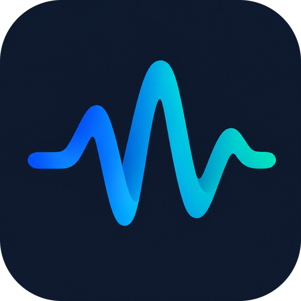
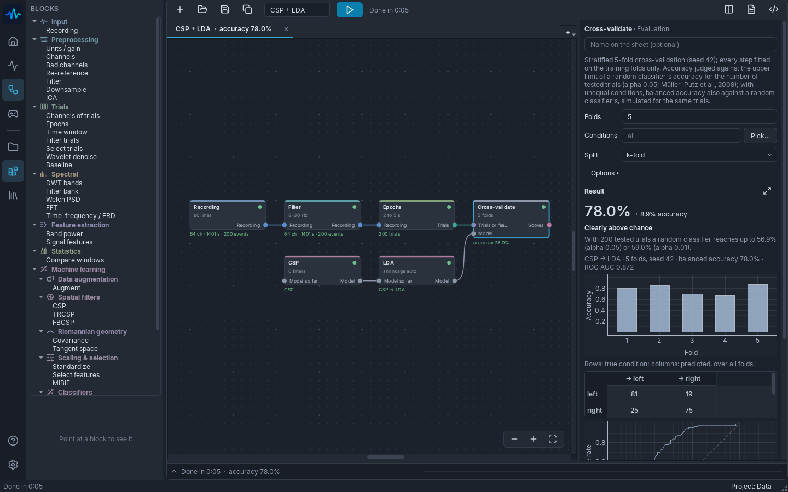
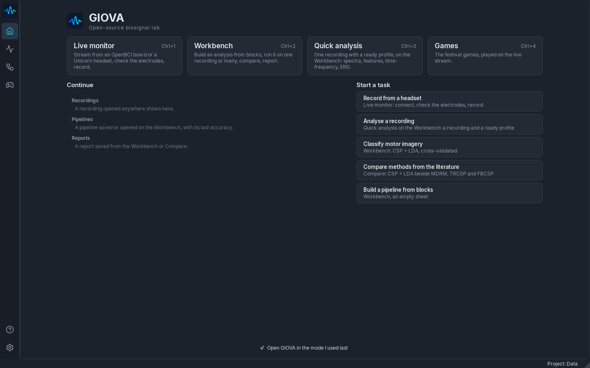
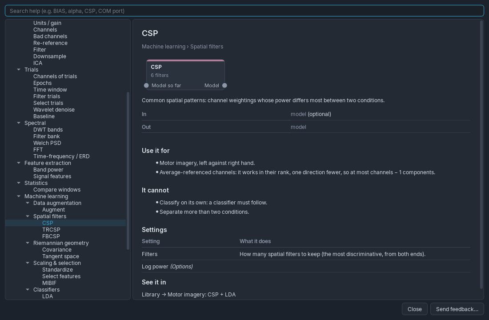

<p align="center">
  
</p>

<h1 align="center">GIOVA</h1>

<p align="center"><b>An open-source biosignal lab for EEG</b><br>
Record from a headset, build an analysis from blocks, see how well it really works, and take it with you as Python.</p>

<p align="center">
  <a href="https://github.com/OWNER/GIOVA/releases/latest"><b>Download for Windows</b></a> ·
  <a href="#build-from-source">Build from source</a> ·
  <a href="https://github.com/OWNER/GIOVA/issues">Feedback</a> ·
  <a href="LICENSE">GPL-3.0</a>
</p>

<picture>
  <source media="(prefers-color-scheme: light)" srcset="docs/images/workbench-light.png">
  
</picture>

---

## What it does

GIOVA is a desktop program for EEG research and teaching. A whole study fits in one window: from the
electrodes on the head to a classification result you can defend and a script others can run.

**Live monitor.** Stream from an OpenBCI Cyton (8 or 16 channels with Daisy) or a g.tec Unicorn through
BrainFlow, check every electrode's signal and impedance, mark events and record.

**Workbench.** Build an analysis by wiring blocks on a sheet: recording → filter → trials → features →
model → cross-validation. Every block shows its result as you go, and only what changed is computed again.
Around 40 blocks in plain groups:

| | |
|---|---|
| Preprocessing | units and gain, channel selection, bad channels and interpolation, re-reference, IIR / FIR / ideal filters, downsampling, ICA |
| Trials | epochs from events or a table, time windows, per-trial filters, picking trials by hand, wavelet denoising, baseline |
| Spectral | Welch PSD, FFT, filter banks, DWT bands, time-frequency (STFT, complex Morlet wavelets) and ERD / ERS |
| Features | band power and ratios, signal features (RMS, Hjorth, entropy), window comparisons with statistics |
| Machine learning | CSP, TRCSP, FBCSP, Riemannian covariance and tangent space, scaling and selection, LDA, SVM, logistic regression, random forest, kNN, MDM, NBPW, cross-validation with nested tuning |

**Honest results.** Every step of a model is fitted inside each training fold, never on the test trials.
Accuracy is read against what a random classifier could reach with that many trials (Müller-Putz et al.,
2008; Combrisson & Jerbi, 2015), balanced accuracy is given when conditions are unequal, and a permutation
test is one click away.

**Compare.** Run several pipelines over many recordings, side by side, with paired statistics, or train on
the other recordings and test on each one in turn.

**Reports and Python.** Save a report as PDF, Word or HTML with the methods written out, the figures and
every trial left out with its reason. Export any pipeline as Python that runs without GIOVA, using
scikit-learn and pyRiemann where they have the step and GIOVA's own code where they give other numbers.

**Files.** MATLAB (v7 and v7.3, with a dialog for any layout), CSV (OpenBCI and plain), EDF / BDF, GDF,
FIF, BrainVision and EEGLAB.

<picture>
  <source media="(prefers-color-scheme: light)" srcset="docs/images/home-light.png">
  
</picture>

## Checked, not assumed

- **562 automated tests** run before every build, and the packaged program checks itself (`GIOVA.exe --selftest`).
- **Against the reference libraries.** CSP, LDA and every classifier give the same predictions as MNE and
  scikit-learn on the same folds; tuning picks the same values as scikit-learn's `GridSearchCV`.
- **On real data.** On the 52 subjects of the Cho2017 motor imagery dataset, CSP + LDA averaged 65.3%,
  against 66.2% for MOABB with the same choices (Wilcoxon p = 0.61). After an average reference, GIOVA's CSP
  and MNE's match subject for subject (Cho2017 subjects 1–5, 74.6% both).
- **The export.** Exported scripts are run in a separate Python where GIOVA cannot be imported, and every
  output is compared with the Workbench's.

<picture>
  <source media="(prefers-color-scheme: light)" srcset="docs/images/help-light.png">
  
</picture>

## Download

1. Download `GIOVA-1.0.0-windows-x64.zip` from the [latest release](https://github.com/OWNER/GIOVA/releases/latest).
2. Unzip it anywhere and run `GIOVA\GIOVA.exe`. Keep the whole folder together; nothing is installed.
3. Windows may say it protected your PC, because the program is not signed yet: choose **More info → Run anyway**.

Windows 10 or 11, 64-bit. About 450 MB on disk once unzipped.

## Build from source

Python 3.13 on Windows:

```bash
git clone https://github.com/OWNER/GIOVA.git
cd GIOVA
python -m venv .venv
.venv\Scripts\python -m pip install -r requirements-dev.txt
.venv\Scripts\python eeg_studio.py
```

`build_exe.bat` runs the tests, builds `dist\GIOVA\GIOVA.exe` with PyInstaller, runs its self-test and zips
it for release. `requirements-lock.txt` pins every package to the versions the release was tested with.

## How it is built

```
ui/        Qt windows: Home, Monitor, Workbench, Help        (PySide6, pyqtgraph)
pipeline/  the engine: blocks, graph, runner, learning, export  (no Qt)
formats/   reading files into one Recording                  (no Qt)
core/      signal processing, devices, projects               (numpy, scipy, MNE, BrainFlow)
```

Dependencies only point downwards. The engine knows nothing about windows, so the Workbench, Compare,
the tests and the exported scripts all run the same code.

## Your data stays with you

GIOVA sends nothing anywhere: no usage statistics, no crash reports, no recordings. Help → **Send feedback**
opens a new issue in your browser with the version filled in; what you write there is all that is shared.

## Not a medical device

GIOVA is for research and teaching. It is not made, tested or approved for diagnosing, monitoring or
treating any condition, and its results must not be used for such decisions. It comes with no warranty.

## Licence

GIOVA is free software under the [GNU General Public License v3.0](LICENSE): use it, study it, share it and
change it; versions you share stay under the same licence, with their source. The libraries it builds on keep
their own licences, listed in [THIRD_PARTY_NOTICES.md](THIRD_PARTY_NOTICES.md).

If GIOVA helps your work, please cite it ([CITATION.cff](CITATION.cff)).
